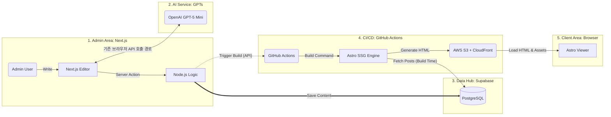

# System Architecture

## Overview



## Flow

1. **콘텐츠 작성**: Admin이 Next.js Editor에서 글 작성 → Server Action → Supabase에 저장
2. **AI 번역**: 현재 기본 작업 흐름은 수동 번역 Sheet이며, 기존 브라우저 OpenAI API 호출 경로도 코드에 남아 있다. `NEXT_PUBLIC_OPENAI_API_KEY`와 브라우저 직접 호출은 키 노출 위험이 있어 서버 이전·키 교체 검토가 별도 후속 작업이다.
3. **빌드 트리거**: Node.js Logic이 GitHub Actions에 빌드 트리거 API 호출
4. **SSG 빌드**: Astro가 빌드 타임에 Supabase에서 전체 포스트 Fetch → 정적 HTML 생성. 다국어 경로 조건부 생성: 포스트 상세는 `is_multilingual === true`인 포스트만, 카테고리/서브카테고리 인덱스는 해당 분류에 multilingual 포스트가 1개 이상 존재할 때만 locale 경로를 생성 (thin content 방지)
5. **배포**: 생성된 HTML을 AWS S3에 업로드, CloudFront CDN으로 서빙. CloudFront Function(Viewer Request)이 `/path/` → `/path/index.html` 매핑을 처리.
6. **사용자 접근**: 브라우저에서 정적 HTML 로드 (JS 최소화)

## Client 빌드 데이터 재사용·증분 빌드

### 전체 수집과 데이터 맵

`shared/lib/build-data.ts`가 posts·post_translations·categories·category_translations를 공통 `fetchAllRows()`로 완전 수집한 뒤 `build-data-index.ts`에서 인덱스를 만든다. 글 ID·slug, 글 ID·언어별 번역, 분류·소분류별 최신순 글 목록과 카테고리 트리를 재사용한다. 기존 post-feed API와 i18n 함수의 인터페이스·필터·번역 대체 동작은 유지하고 목록·건수·피드 페이지를 메모리에서 파생한다. 글 본문까지 매 빌드 수집하며 DB에 캐시 키 컬럼을 추가하지 않는다.

프로덕션 빌드에서는 `Symbol.for`로 수집 중인 Promise까지 공유한다. `astro:build:start`에서 이전 상태를 지우므로 같은 프로세스에서 다음 빌드를 시작해도 최신 데이터를 수집한다. 개발 서버는 `astro:server:setup` 미들웨어의 `AsyncLocalStorage` 요청 컨텍스트에서 Promise를 공유하고 다음 요청은 다시 수집한다. 요청 컨텍스트가 없으면 새로 수집한다. 이 맵은 빌드를 실행하는 Node.js의 RAM이며 디스크의 이전 HTML 캐시와 다르다.

### 페이지별 캐시 키

`experimental.incrementalBuild`를 활성화했다. 한국어·다국어 상세/대분류/소분류, 다국어 홈의 7개 동적 라우트 파일에서 `getStaticPaths()`가 페이지별 `cacheKey`를 반환한다. 한국어 홈처럼 `getStaticPaths()`가 없는 페이지와 키를 지정하지 않은 검색·소개·개인정보·404·피드 JSON·robots 등의 출력은 계속 생성한다. sitemap도 현재 경로 목록에서 갱신한다.

한국어 홈은 고정 `index.astro`라 현재 구조에서 증분 캐시 대상이 아니고, 다국어 홈은 `[locale]/index.astro`의 동적 경로이므로 적용된다. 언어 자체의 제약은 아니다. 검색·피드 JSON은 모든 언어에서 캐시 키를 지정하지 않은 구현 선택이다. 우선 상세·분류 화면에 집중해 검증 범위를 제한했으며, 재생성 시에도 수집한 맵을 사용하므로 DB 추가 조회는 없다. 검색·피드만의 생성 비용과 캐시 적용 효과는 따로 측정하지 않았으므로 효과가 낮다고 단정하지 않는다. CI 측정에서 필요성이 확인되면 해당 출력의 의존성과 지원 범위를 확인해 확대한다.

`shared/lib/page-cache-model.ts`는 객체 키를 정렬하고 배열 순서를 보존해 모델 버전과 SHA-256을 계산한다. `page-cache.ts`의 모델은 다음 데이터를 포함한다.

| 범위 | 해시에 포함하는 값 |
| --- | --- |
| 공통 | locale, 해당 언어의 DB 분류 트리·활성 분류/소분류, 현재 연도, 출력에 관여하는 공개 환경값(`PUBLIC_*`, `SITE`, `BASE_URL`, `MODE`, `DEV`, `PROD`) |
| 상세 | 언어 적용 후 자기 글 전체(원문 수정 시각 포함), 분류 라벨, 본문 내부 북마크의 번역 적용 결과, 실제 추천 첫 4개 및 인접 최대 4개의 카드 데이터 |
| 목록 | 경로 범위, 첫 10개 카드 데이터, 다음 페이지 존재 여부, 실제 추천 첫 4개, 다국어 선택 가능 여부, 홈 제목의 분류 라벨 |
| 카드 | 제목·설명·slug·분류·썸네일/대체 텍스트·배지/추적 값·작성 시각·원문/번역 장소명. 본문과 수정 시각은 제외 |

상세의 추천·인접 글은 `getPostPageContext()`를 캐시 계산과 `PostLayout.astro`가 공유한다. 인접 글은 현재 글 앞 한 칸부터 최대 4개이며 현재 글도 포함한다. 목록 ID가 같아도 참조한 글의 카드 값이 바뀌면 키가 달라진다. 모든 글의 전체 데이터를 모든 키에 넣거나 DB 변경을 관계 그래프로 전파하지 않는다. 페이지 모델을 최신 맵에서 다시 만들고 이전 빌드의 키와 비교한다. 템플릿·모듈 코드 변경은 Astro의 의존성 해시가 추가로 검사한다.

원문 `updated_at`을 다국어 상세 JSON-LD의 `dateModified`로 사용하는 기존 정책을 유지한다. 원문 수정으로 번역 내용이 그대로인 다국어 상세도 재생성될 수 있으며, 번역 레코드 수정이나 재번역을 뜻하지 않는다. 번역 설명/alt의 `||` 대체, 빈 이미지 배열 대체도 유지한다.

### 수집 누락 방지와 한계

Supabase의 기본 상한은 한 요청당 반환 1,000행이며 프로젝트 설정에 따라 달라질 수 있다. 각 테이블은 최대 500행씩 요청하고 exact 전체 건수에 도달할 때까지 실제 받은 행 수만큼 offset을 진행한다. 요청 크기보다 적은 응답이 와도 종료하지 않는다. 같은 조회의 exact 건수·고유 키를 검사하며 누락·중복·건수 변경·조회 오류 시 자동 재시도 없이 빌드를 실패시킨다. 수집 실패를 빈 데이터나 정상 삭제로 처리하지 않는다. 참고: [Supabase 조회 제한](https://supabase.com/docs/reference/javascript/select), [range 조회](https://supabase.com/docs/reference/javascript/range).

글은 `created_at DESC, id ASC`, 활성 분류 추출은 ID 순으로 처리한다. 카테고리는 `sort_order, id`, 번역은 고유 복합 키 순으로 수집한다. 화면 피드도 같은 작성 시각에 ID를 추가 정렬해 전체 목록과 순서를 맞춘다. 공용 배열을 제자리 정렬/삭제하거나 원문 객체에 번역을 덮어쓰지 않는다.

여러 REST 요청은 DB의 동일 시점 스냅샷을 보장하지 않는다. 같은 건수를 유지한 동시 교체·수정까지 검출하는 기능은 없다. 전체 수집은 글·번역 본문 크기에 비례해 RAM·전송량을 사용하며, 큰 단일 분류에서는 추천 목록 필터링·인접 위치 탐색의 반복 비용도 남는다. 규모 확장 시 가벼운 전체 메타데이터와 신뢰할 수 있는 본문 버전, 분류별 필터/위치 인덱스를 측정에 따라 검토한다.

### 검증과 초기 측정

이전 임시 실험은 동일 Supabase HTTP 요청의 응답만 재사용하여 1,033회→98회, 26.57초→4.33초를 측정했으며 제품 구현과 구분한다. 이번 구현은 데이터 맵을 적용해 실제 로컬 연결(글 8건·번역 28건·분류 6건·분류 번역 14건, 출력 89페이지)에서 테이블당 1회, 총 4회 통신을 확인했다. 무변경 빌드는 대상 63/63경로를 복원하고 나머지 출력은 생성하며, 전체 파일 109개가 강제 빌드와 SHA-256 기준으로 일치했다. 최종 로컬 측정은 강제 전체 빌드 2.09초, 무변경 증분 빌드 1.76초, 증분 캐시 약 4.2MB였다. 이 수치는 네트워크 상태의 영향을 받는 단일 로컬 연결의 결과이며 CI·운영 전체 글 규모의 성능 보장은 아니다. 구현 전 로컬 출력 109개와도 바이트 단위로 일치했다.

`pnpm --filter @eunminlog/client test:incremental`은 임시 앱·독립 캐시/출력과 fetch fixture를 사용해 외부 네트워크를 차단한다. 실제 Astro 34빌드에서 무변경 135/135경로 재사용, 제목/본문·번역·발행·삭제·추천·slug/분류 이동·다국어 해제·북마크 대상 번역·마지막 분류 글 삭제·분류 라벨·피드 10↔11·서버 반환 상한 3행·환경·템플릿 변경을 검증했다. 각 변경의 증분 출력과 `--force` 전체 출력이 모두 일치했다. 원문 수정 시각과 번역 대체·카드 값·인접 경계·요청별 Promise 공유를 포함해 Client 단위 테스트 66개·린트·TypeScript 검사도 통과했다. 배포 전 최신 develop을 통합하면서 GA 초기화 테스트를 함께 유지했고 Client 67개·Admin 167개 테스트, Client 린트·타입 검사와 양 앱 전체 빌드를 다시 통과했다. 별도의 동일 production fixture에서 구현 전 코드와 비교한 출력 205개도 모두 바이트 단위로 일치했다. DEV 실제 HTTP 첫 요청은 4테이블 총 4회 조회했고, fixture 제목 수정 후 같은 페이지를 다시 요청하면 새로 4회 조회해 변경된 제목을 표시했다. 테스트 서버는 종료했다.

캐시 보존과 실제 GitHub 서버 저장/복원 구분, 실패 처리 및 실행별 키 정책은 [ci-cd.md](ci-cd.md)의 Astro 빌드 캐시 보존을 참조한다. 이번 검증에서 운영 DB 수정·커밋·푸시·배포는 수행하지 않았다.

## App별 역할

| App           | Framework               | 역할                      | 렌더링                                                      |
| ------------- | ----------------------- | ------------------------- | ----------------------------------------------------------- |
| `apps/admin`  | Next.js 15 (App Router) | 글 작성/편집, 빌드 트리거 | CSR + 관리자 검사된 Server Action/Route Handler. 기존 GPT 브라우저 호출은 보안 후속 대상 |
| `apps/client` | Astro 7.2.0              | 공개 블로그 뷰어          | SSG                                                         |

2026-10-17 업그레이드 검증: Tailwind 4.2.2 적용 후 Admin 테스트 163개·빌드를 통과했다. Astro 7.2.0에서 거부된 `SubCategoryTabs.astro`의 동기 `map` 콜백 내 `await`는 frontmatter의 `Promise.all` 라벨 조회로 옮겼다. 공백 압축으로 붙어 보이던 장소·제품·기본 정보 카드의 카테고리 링크와 구분자는 CSS 가로 간격 4px로 명시했다. 최종 클라이언트 테스트 31개·린트·89페이지 전체 빌드를 통과했으며, Astro 5.17.2 + Tailwind 4.2.2 빌드와 홈·검색·한국어/영어 상세·대분류·소분류 8개 경로를 PC 1440px 및 모바일 390px에서 비교한 16개 조합도 통과했다. 비교 항목은 표시 텍스트·링크·선택 상태·주요 요소 위치/크기·스타일·브라우저 오류이며, 수정된 카테고리 행의 간격 4px도 확인했다. 브라우저 비교는 외부 요청을 차단하여 실제 광고 응답은 검증하지 않았다. 이 업그레이드 검증 단계에서는 증분 빌드를 활성화하지 않았으며, 이후 위 Client 빌드 데이터 재사용·증분 빌드 작업에서 활성화했다.

추가 빌드 점검(2026-10-17): 작업 파일에서 되돌아간 `SubCategoryTabs.astro`를 기존 스테이징 수정본으로 복원했다. Admin의 `zodResolver(postFormSchema)` 타입 오류는 스키마의 Zod 4.3.6과 resolver가 공용 경로에서 참조한 Zod 3.25.76 내 v4 타입(4.0.0)의 불일치로 확인했다. 루트 `package.json`의 `pnpm.packageExtensions`에서 `@hookform/resolvers@5.2.2`에 `zod: ^3.25.0 || ^4.0.0` peer를 보완하여 Admin과 동일한 Zod 4.3.6에 연결한다. 이 설정은 해당 resolver 버전에만 적용하며 다른 패키지의 Zod를 일괄 변경하지 않는다. Admin 소스 수정 없이 테스트 163개·린트·프로덕션 빌드(타입 검사 포함), 클라이언트 89페이지 빌드, `pnpm install --frozen-lockfile --offline` 검증을 통과했다.

최종 회귀 점검(2026-10-17): 현재 작업 파일과 스테이징이 일치하는 상태에서 단위 테스트 198개(Admin 163·클라이언트 31·공유 링크 정책 4), 양 앱 린트와 전체 `pnpm build`, PC/모바일 편집기 하네스 E2E 116개를 통과했다. 클라이언트 89개 HTML 경로의 언어·제목·메타·canonical/hreflang·JSON-LD 197개, robots와 sitemap을 Astro 5 빌드와 비교해 일치함을 확인했으며 로컬 스크립트/스타일 참조 305개의 파일 존재도 확인했다. E2E는 업로드·임시저장 응답을 모킹하며 실서비스 로그인·저장·업로드·광고 실응답은 검증 범위에서 제외한다. 기존 Tiptap peer 버전 경고와 로컬 Turbo 린트 캐시 쓰기 권한 경고는 남아 있으나 이번 테스트·린트·빌드 실패는 없었다.

의존성·캐시 경고 정리(2026-10-17): Tiptap의 `core`·`pm`만 3.20.1로 올려 기존 확장들의 peer 범위를 충족했으며, 다른 확장은 기존 3.20.0/3.20.1을 유지했다. 설치 시 Tiptap peer 경고가 사라졌다. Turbo 권한 경고는 원본 저장소 `/Users/semnil5202/Documents/vscode/eunminlog/.turbo/cache`의 공유 캐시에 쓰려다가 발생했다. `turbo.json`에 워크트리 상대 `cacheDir: .turbo/cache`를 명시한 뒤 일반 `pnpm lint`에서 권한 경고 없이 2개 작업 모두 cache hit를 확인했다. 변경 후 단위 테스트 198개·린트·양 앱 전체 빌드(클라이언트 89페이지)는 통과했다. 편집기 E2E에서 드러난 이미지 선택자 문제는 `image-alt.spec.ts`의 이미지 접근을 `.tiptap img:not(.ProseMirror-separator)` 공통 함수로 통일하여 보완했다. 표시·클릭·삭제/Undo 후 개수 검증에서 편집기 보조 이미지를 제외한다. 제품 소스 추가 수정 없이 이미지 관련 PC/모바일 14개와 전체 편집기 E2E 116개가 통과했으며, 테스트 파일의 린트·포맷 검사도 통과했다. 이번 검증 범위에서는 실제 이미지 기능의 회귀가 재현되지 않았다.

## Admin 인증·권한 경계

- Supabase Auth 계정은 관리자만 수동 발급한다. 배포 전 기존 계정에 서버 관리 `app_metadata.role=admin`을 부여한다. 이번 경계 보완은 기존 Auth 메타데이터를 사용하며 DB 테이블·컬럼 추가나 SQL 마이그레이션이 없다.
- 페이지 미들웨어는 `auth.getUser()`와 역할을 검사해 미인증 사용자를 `/login`으로 보내고 권한 없는 로그인 사용자에게 403을 응답한다. `/api/`는 matcher에서 제외되므로 임시저장·OG Route Handler가 직접 검사한다. Route Handler의 미인증 응답은 401, 관리자 권한 없음은 403이다.
- 게시글·카테고리 조회/수정, 슬러그 중복 확인, 이미지 업로드 URL 발급, 빌드 요청의 Server Action도 각 진입점에서 직접 검사한다. Supabase service role 키로 DB에 접근하거나 S3·GitHub 기능을 호출하기 전에 권한을 확인한다. 미들웨어는 독립적인 서버 권한 검사를 대체하지 않는다.
- 임시저장의 최대 10개 정책과 오래된 초안 삭제는 관리자 검사 이후에만 실행한다. OG 조회는 URL·DNS·리다이렉트 목적지를 검증하고 응답 형식·크기·전체 시간 및 호출량을 제한한다. 현재 호출량 제한은 서버 인스턴스 메모리에만 적용되므로 분산 배포 전체의 제한은 보장하지 않으며, 배포 전 플랫폼 규칙을 검토한다.
- 공개 검색 API는 이번 작업에 포함되지 않는다. 운영 배포 코드와 Vercel 추가 접근 제한, 운영 환경의 실제 무인증 호출 가능성은 검증하지 않았다. 운영 데이터를 생성·수정·삭제하는 방식의 보안 시험은 수행하지 않는다.

## 외부 서비스

| 서비스                | 용도                                                                                             |
| --------------------- | ------------------------------------------------------------------------------------------------ |
| Supabase (PostgreSQL) | 콘텐츠 DB                                                                                        |
| OpenAI GPT-5 Mini     | 다국어 번역                                                                                      |
| GitHub Actions        | CI/CD, SSG 빌드                                                                                  |
| AWS S3 + CloudFront   | 정적 호스팅 + CDN (Client SSG)                                                                   |
| AWS S3 + CloudFront   | 미디어 CDN (이미지/폰트, 1년 캐시). 상세: [`secrets-reference.md`](secrets-reference.md) 섹션 12 |
| @astrojs/sitemap      | Sitemap 자동 생성 (8 locale hreflang alternate, `/search/` 제외)                                 |

## Client App Directory Structure (`apps/client`)

```
src/
├── features/
│   ├── post-feed/                          # 카드 피드 (카테고리/서브카테고리 리스트)
│   │   ├── components/
│   │   │   ├── PostCard.astro              # 단일 포스트 카드
│   │   │   ├── PostCardGrid.astro          # 카드 그리드 + InFeedAdsense + 페이지네이션
│   │   │   └── SponsoredCard.astro         # 협찬글/인기글 상태 카드
│   │   ├── api/
│   │   │   ├── posts.ts                    # 포스트 데이터 fetch (빌드 타임, Supabase)
│   │   │   ├── translations.ts             # 번역 데이터 fetch (빌드 타임, Supabase)
│   │   │   └── categories.ts              # 카테고리 데이터 fetch (빌드 타임, Supabase categories 테이블)

│   ├── post-detail/                        # 포스트 상세 페이지
│   │   ├── components/
│   │   │   ├── PlaceInfoCard.astro         # 장소 정보 카드 (Schema.org LocalBusiness)
│   │   │   ├── NearbyPostList.astro        # 같은 서브카테고리 인근 포스트 목록
│   │   │   └── PostBadges.astro            # 협찬글/인기글 뱃지 조합
│   │   └── lib/
│   │       ├── ads.ts                      # insertInArticleAds() — H2 섹션 경계 광고 삽입
│   │       └── schema.ts                   # buildBlogPostingSchema() JSON-LD
│   ├── search/                             # 검색 기능
│   │   ├── components/
│   │   │   └── SearchUI.astro              # 검색 폼 + 추천 키워드 + 결과 리스트 + 클라이언트 스크립트
│   │   └── api/
│   │       └── search-data.ts              # buildSearchData() — 검색용 JSON 데이터 변환
│   └── consent/                            # 쿠키 동의 배너 (GDPR/APPI/PIPL/PDPA)
│       └── components/
│           └── CookieConsentBanner.astro   # Sticky Footer 배너 (en/ja/zh-CN/th locale만 렌더링)
├── shared/
│   ├── components/
│   │   ├── ad/
│   │   │   ├── AdSlot.astro                # provider 중재용 광고 슬롯 메타데이터
│   │   │   ├── FixedAdsense.astro          # Display 광고 (variant: 'post-top' | 'sidebar')
│   │   │   └── InFeedAdsense.astro         # Feed/Search Native In-feed 광고
│   │   ├── layout/
│   │   │   ├── Header.astro                # 반응형 헤더 (PC/Mobile CSS 토글)
│   │   │   ├── PCHeader.astro              # PC 헤더 (LanguageSelector + getActiveSegments)
│   │   │   ├── MobileHeader.astro          # 모바일 헤더 (snap scroll nav)
│   │   │   ├── Footer.astro                # 푸터 (SEO 링크)
│   │   │   ├── LeftSidebar.astro           # 좌측 사이드바 (CategoryTree 포함)
│   │   │   ├── RightSidebar.astro          # 우측 사이드바 (FixedAdsense + SponsoredPostList)
│   │   │   ├── ThreeColumnLayout.astro     # 3-Column 그리드 레이아웃
│   │   │   ├── SponsoredPostList.astro     # 페이지 범위별 제목을 받는 인기글 리스트
│   │   │   ├── SponsoredPostItem.astro     # 인기글 단일 아이템
│   │   │   ├── BloggerProfile.astro        # 블로거 프로필 (LeftSidebar 하단)
│   │   │   └── BaseHead.astro              # <head> 메타/SEO 공통 요소
│   │   ├── navigation/
│   │   │   ├── CategoryTree.astro          # 카테고리 트리 (getActiveSegments)
│   │   │   ├── Breadcrumb.astro            # 브레드크럼 네비게이션
│   │   │   ├── SubCategoryTabs.astro       # 모바일 서브카테고리 탭
│   │   │   └── LanguageSelector.astro      # details/summary 언어 선택 드롭다운
│   │   ├── seo/
│   │   │   ├── JsonLd.astro                # JSON-LD 공통 래퍼
│   │   │   ├── BlogPostingJsonLd.astro     # BlogPosting 스키마
│   │   │   ├── BreadcrumbJsonLd.astro      # BreadcrumbList 스키마
│   │   │   ├── OpenGraph.astro             # Open Graph 메타 태그
│   │   │   └── Hreflang.astro              # hreflang 대체 링크
│   │   └── ui/
│   │       ├── ImageLightbox.astro         # 전역 이미지 라이트박스 (Layout에 1회 삽입)
│   │       ├── PostBadge.astro             # 협찬글/인기글 상태 뱃지
│   │       └── Toast.astro                 # 전역 토스트 알림 (Layout에 1회 삽입)
│   ├── constants/
│   │   └── consent.ts                      # CONSENT_REQUIRED_LOCALES, CONSENT_COOKIE_NAME, CONSENT_COOKIE_MAX_AGE
│   ├── lib/
│   │   ├── consent.ts                      # isConsentRequired(), getConsentState(), setConsentCookie()
│   │   ├── date.ts                         # formatDate(dateStr, locale)
│   │   ├── navigation.ts                   # getActiveSegments(pathname, locale)
│   │   └── i18n/
│   │       ├── locales.ts                  # locale 설정, getLocalePath()
│   │       ├── categories.ts               # getCategoryLabel()
│   │       └── translations.ts             # t() 번역 함수
│   └── types/
│       ├── category.ts                     # CategorySlug, CategoryNode (동적 카테고리 타입)
│       ├── common.ts                       # Locale, LOCALES, DEFAULT_LOCALE
│       ├── post.ts                         # LocalizedPost
│       └── seo.ts                          # BlogPostingSchema, ReviewSchema
├── layouts/
│   ├── Layout.astro                        # 루트 레이아웃
│   ├── ListLayout.astro                    # 리스트 페이지 레이아웃 (3-Column)
│   └── PostLayout.astro                    # 포스트 상세 레이아웃
├── pages/                                  # Astro 파일 라우팅
│   └── robots.txt.ts                       # robots.txt API Route (동적 생성)
└── styles/                                 # 글로벌 스타일
```

## Admin App Directory Structure (`apps/admin`)

```
src/
├── app/                                       # Next.js App Router
│   ├── api/drafts/                            # 임시저장 API Route
│   ├── categories/                            # 카테고리 관리 페이지
│   ├── dashboard/                             # 대시보드
│   ├── drafts/                                # 임시저장 목록
│   ├── login/                                 # 로그인
│   └── posts/                                 # 포스트 생성/편집/목록
├── features/
│   ├── build-trigger/                         # SSG 빌드 트리거
│   │   └── api/actions.ts                     # GitHub Actions 트리거 Server Action
│   ├── category-management/                   # 카테고리 CRUD
│   │   └── api/                               # Server Actions + 클라이언트 API
│   ├── draft/                                 # 임시저장
│   │   ├── hooks/useAutoSaveDraft.ts          # 자동 저장 훅
│   │   ├── api.ts                             # 임시저장 API 클라이언트
│   │   └── types.ts
│   ├── media/                                 # 이미지 업로드
│   │   ├── api/actions.ts                     # S3 presigned URL 생성 Server Action
│   │   ├── constants/media.ts                 # 이미지 사이즈/포맷 상수
│   │   ├── lib/upload-image.ts                # 원본·688px·선택적 OG 이미지 S3 업로드
│   │   ├── lib/validate-image.ts              # 입력 이미지 형식·크기 검사
│   │   └── hooks/useImageUpload.ts            # 업로드 훅
│   ├── post-editor/                           # Tiptap 에디터
│   │   ├── components/                        # 에디터 UI (Toolbar, TiptapEditor 등)
│   │   ├── containers/TiptapEditorContainer.tsx
│   │   ├── hooks/useTiptapEditor.ts
│   │   ├── hooks/useMediaIntake.ts            # 파일별 업로드 세션·캐러셀 생성/추가
│   │   ├── containers/MosaicEditorContainer.tsx # 단일·캐러셀 공통 인라인 모자이크 편집/저장
│   │   ├── lib/mosaic.ts                     # 영역 좌표·고정 강도 Canvas 픽셀 처리
│   │   ├── lib/mosaic-target.ts              # 비동기 편집 대상 추적·Undo 단위 URL 교체
│   │   ├── hooks/useImageTransfer.ts          # 본문 파일 paste/drop·드롭 위치·내부 드래그 구분
│   │   ├── configs/                           # Tiptap 확장 설정
│   │   ├── lib/carousel-node-view.ts          # 캐러셀별 스크롤·리사이즈·명시적 조작
│   │   ├── lib/media-insertion.ts             # 비동기 삽입 대상 추적·일괄 삽입
│   │   ├── api/                               # 포스트 저장/수정 Server Actions
│   │   ├── lib/image.ts                       # 이미지 처리 유틸
│   │   ├── constants/category.ts
│   │   └── types/form.ts
│   ├── post-management/                       # 포스트 목록/삭제
│   │   └── api/actions.ts
│   └── translation/                           # AI 번역
│       ├── api/client.ts                      # OpenAI GPT 호출 (전체/선택적 번역, AbortSignal 지원)
│       ├── components/
│       │   ├── TranslationSheet.tsx            # 번역 확인 Sheet (섹션 기반 체크박스, dirty tracking, 선택적 재번역)
│       │   ├── TermReviewItem.tsx              # 고유명사 검토 아이템
│       │   └── TermReviewList.tsx              # 고유명사 검토 리스트
│       ├── containers/TranslationSheetContainer.tsx  # 고유명사 추출 + 번역 실행
│       ├── hooks/
│       │   ├── useTranslationDirtyFields.ts   # 번역 시점 vs 현재 폼 값 비교 훅
│       │   └── useTranslationCheckState.ts    # 필드+섹션 체크박스 상태 관리 훅
│       ├── lib/html-sections.ts               # HTML 섹션 분할/재조립/dirty 비교 유틸리티
│       ├── constants/locale.ts
│       └── types/index.ts                     # ContentSection, CheckableField, SelectiveTranslateOptions 타입 포함
├── shared/
│   ├── components/
│   │   ├── filter/SearchFilter.tsx            # 검색 필터
│   │   ├── layout/AppSidebar.tsx              # 사이드바 네비게이션
│   │   ├── pagination/Pagination.tsx          # 페이지네이션
│   │   ├── slug/SlugField.tsx                 # 슬러그 입력 필드
│   │   └── ui/AiGenerateButton.tsx            # AI 생성 버튼
│   ├── constants/prompts.ts                   # GPT 시스템 프롬프트
│   ├── lib/
│   │   ├── openai.ts                          # OpenAI 클라이언트 인스턴스
│   │   ├── supabase.ts                        # Supabase 브라우저 클라이언트
│   │   ├── supabase-server.ts                 # Supabase 서버 클라이언트
│   │   └── supabase-middleware.ts             # Supabase 미들웨어 클라이언트
│   └── types/post.ts                          # 포스트 공유 타입
├── components/ui/                             # shadcn/ui 프리미티브
├── hooks/use-mobile.ts                        # 모바일 감지 훅
├── lib/utils.ts                               # cn() 유틸
└── middleware.ts                              # 인증 미들웨어
```

## Search Architecture

- **데이터 전략**: 빌드 타임에 전체 포스트를 JSON으로 직렬화하여 검색 페이지 HTML에 인라인 삽입
- **검색 실행**: 클라이언트 JavaScript가 JSON을 파싱하여 title, description, place_name 기준으로 필터링
- **DB 의존성 없음**: 런타임 DB 쿼리 없이 완전한 정적 페이지로 동작
- **라우팅**: `/search/` (한국어), `/{locale}/search/` (다국어)
- **Header**: PC/Mobile 헤더 모두 순수 HTML/CSS — JavaScript 없음 (검색 버튼은 `/search/`로의 `<a>` 링크)

## 로컬 HTTPS 개발 환경

양 앱 모두 mkcert 기반 self-signed 인증서를 사용한 HTTPS 로컬 개발 환경을 제공한다.

| 앱     | 도메인                                | 포트 | 셋업 스크립트                              |
| ------ | ------------------------------------- | ---- | ------------------------------------------ |
| Admin  | `https://local-admin.eunminlog.site`  | 4322 | `apps/admin/scripts/setup-local-https.sh`  |
| Client | `https://local-client.eunminlog.site` | 4321 | `apps/client/scripts/setup-local-https.sh` |

- **일괄 셋업**: `pnpm setup:local` (root) -- client + admin 동시 실행
- Admin은 `scripts/start-local-server.cjs` (Node.js HTTPS + Next.js handler)로 서버 구동
- Client는 `astro.config.mjs`에서 Vite HTTPS 설정 (`vite.server.https`)으로 구동

## Admin 배포 환경

| 환경       | 도메인                                    | Git 브랜치 | 비고                       |
| ---------- | ----------------------------------------- | ---------- | -------------------------- |
| Local      | `https://local-admin.eunminlog.site:4322` | —          | mkcert HTTPS               |
| Preview    | `https://cms-e-dev.vercel.app`            | develop    | Vercel Preview             |
| Production | `https://cms-e-prod.vercel.app`           | main       | Vercel Production          |
| Custom     | `https://admin.eunminlog.site`            | main       | 커스텀 도메인 (Production) |

## 공유 패키지

| 패키지                   | 역할                                                        |
| ------------------------ | ----------------------------------------------------------- |
| `packages/tsconfig`      | 공유 TypeScript 설정 (base, nextjs, astro)                  |
| `packages/eslint-config` | 공유 ESLint Flat Config                                     |
| `packages/config`        | 공유 Tailwind 테마 (`theme.css` — 컬러 팔레트, 시맨틱 토큰) |
